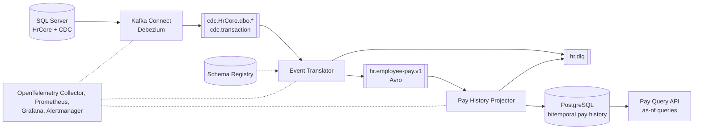

# CDC Pay Events PoC

Proof of concept: SQL Server change data capture → Debezium → Kafka → versioned,
effective-dated business events (`EmployeeHired`, `SalaryChanged`,
`SalaryCorrected`, `PositionChanged`, `EmployeeTerminated`) with
schema-registry compatibility rules, a bitemporal read model with as-of
queries, replay, idempotency, monitoring, and scripted failure drills.
Synthetic HR/pay data only. **Not production.**

## Architecture



Debezium turns row changes into one topic per table plus a transaction
topic. The translator assembles each source transaction, classifies it into
business events, and publishes them under a registered Avro contract; what it
cannot classify goes to `hr.dlq` with a reason. The projector applies events
to a read model with valid time and recorded time, so the Query API answers
"what was the salary on date D, as known at time K". Details:
[docs/architecture.md](docs/architecture.md).

| Component | Technology |
|---|---|
| Source database `HrCore` | SQL Server 2022 with CDC and SQL Server Agent |
| Broker | Apache Kafka, single node, KRaft |
| CDC | Kafka Connect + Debezium SQL Server connector, with a task watchdog |
| Contracts | Avro schemas in Confluent Schema Registry |
| Event Translator | .NET 10 worker: raw CDC → business events |
| Pay History Projector | .NET 10 worker: business events → bitemporal read model in PostgreSQL |
| Pay Query API | ASP.NET Core minimal API: as-of salary queries |
| Monitoring | OpenTelemetry Collector, Prometheus, Grafana, Alertmanager |

## Quick Start

```sh
cp .env.example .env          # then set the passwords
bash scripts/walkthrough.sh --fresh   # start everything and walk through the pipeline (about 3 minutes once images are built)
```

Or step by step:

```sh
scripts/stack-up.sh          # SQL Server with CDC, Kafka, Debezium, Schema Registry, translator, projector, PostgreSQL, Query API, monitoring
bash scripts/scenarios/03-retroactive-raise.sh      # a backdated raise, answered as of then and as of now
curl -s 'http://127.0.0.1:5103/tenants/1/employees/1003/salary-history'
```

Details: [docs/getting-started.md](docs/getting-started.md),
[docs/walkthrough.md](docs/walkthrough.md).

## Scenarios and Drills

`scripts/scenarios/` (each ends with `PASS` or `FAIL`):

| # | Scenario |
|---|---|
| 1 | initial snapshot: every seeded employee as `EmployeeHired`; read model equals the source |
| 2 | raise effective next month |
| 3 | retroactive raise: recorded today, effective three months ago; as-of queries before and after |
| 4 | correction: `SalaryCorrected`, the earlier version kept in the history |
| 5 | hire touching three tables in one transaction: one `EmployeeHired` |
| 6 | replay of business events and of raw CDC: read model unchanged |
| 7 | dead letters: invalid row and poison messages; both services keep going |

`scripts/drills/`: failures, observed and checked; results in
[docs/journal.md](docs/journal.md):

| # | Drill | Outcome |
|---|---|---|
| 1 | Kafka Connect stopped mid-transaction, changes made, restarted | resumes from the stored offset, every change once |
| 2 | SQL Server Agent stopped | capture stops silently; `CdcEventsStalled` fires; catches up after the start |
| 3 | Connect down past the CDC retention | loss detected before and at the restart; repaired by re-snapshot |
| 4 | projector killed mid-backlog | redelivered events skipped; rebuild gives the same checksum |
| 5 | column added without a new capture instance | invisible downstream; backfills need the column excluded |
| 6 | incompatible schema | stopped by the registry and the CI gate |
| 7 | poison messages on every consumed topic | dead-lettered without quoting content; `DlqNotEmpty` fires |

## Design Decisions

- **Business events, not table mirrors.** One source transaction that states
  one business fact becomes one event; the translator waits for the
  transaction to be complete. Unknown shapes are dead-lettered, never
  dropped.
- **Two time axes.** Events carry valid time (`effectiveFrom`, `effectiveTo`)
  and recorded time (`recordedAt`, the source commit time). The read model
  never overwrites; a new fact closes the earlier recorded version.
- **Deterministic event ids and idempotent consumers.** Ids derive from the
  source position (snapshot rows: from the content); the projector stores
  processed ids in the same database transaction as its changes. Replays,
  redeliveries, and crashes change nothing.
- **Contracts only through the registry gate.** Schemas are registered by
  script under `FULL_TRANSITIVE` (also the registry default); producers never
  auto-register; CI rejects a breaking contract.
- **Redelivery-aware transaction assembly.** A transaction's END comes with
  the next transaction, and Debezium sends rows again after a restart; the
  translator waits through an outage and recognises a resent change by its
  source position.
- **Repair is explicit.** A known Debezium task failure is restarted by a
  narrow watchdog; anything lossy (a re-snapshot after the CDC retention was
  exceeded) is an operator action with a runbook, never automatic.
- **One translator instance.** Assembling transactions across topics needs a
  single consumer: a deliberate PoC limitation.

More, with the reasons: [docs/architecture.md](docs/architecture.md),
[docs/event-design.md](docs/event-design.md),
[docs/read-model.md](docs/read-model.md).

## Documentation

| Document | Content |
|---|---|
| [docs/getting-started.md](docs/getting-started.md) | prerequisites, first start |
| [docs/walkthrough.md](docs/walkthrough.md) | the guided run through the pipeline |
| [docs/architecture.md](docs/architecture.md) | components, data flow, design decisions |
| [docs/event-design.md](docs/event-design.md) | topics, events, envelope, compatibility |
| [docs/read-model.md](docs/read-model.md) | bitemporal pay history, projection, Query API |
| [docs/configuration.md](docs/configuration.md) | secrets, ports, service settings |
| [docs/operations.md](docs/operations.md) | start, stop, inspect, replay, backfill, re-snapshot, drills |
| [docs/monitoring.md](docs/monitoring.md) | metrics, dashboard, alerts, runbook per alert |
| [docs/testing.md](docs/testing.md) | test projects and gates |
| [docs/journal.md](docs/journal.md) | what broke and how it was fixed, drill results |

## Build and Test

```sh
bash ci/dotnet-gates.sh       # restore, build, unit tests, format: what CI runs
bash ci/integration-tests.sh  # projector and read model against Kafka, Schema Registry, PostgreSQL (Docker)
sh ci/schema-compat.sh http://127.0.0.1:8081   # contract compatibility (needs a Schema Registry)
```

Or step by step:

```sh
cd src
dotnet restore ./CdcPay.slnx
dotnet build ./CdcPay.slnx -c Release --no-restore
dotnet test --project CdcPay.UnitTests/CdcPay.UnitTests.csproj -c Release --no-build
dotnet format ./CdcPay.slnx --verify-no-changes
```

Each service reports its version, commit, and branch at
`/system/component-identity` and in its first log line.

## Versions

Pinned on 2026-10-29. Images are taken a few weeks after release where a
newer one existed (for example Debezium 3.7.0 was one day old).

| Component | Version |
|---|---|
| SQL Server | `mcr.microsoft.com/mssql/server:2022-CU27-ubuntu-22.04` |
| Kafka | `apache/kafka:4.3.2` |
| Debezium Connect | `quay.io/debezium/connect:3.6.2.Final` (Kafka Connect 4.3.0), plus the Prometheus JMX exporter agent 1.6.0 |
| Schema Registry | `confluentinc/cp-schema-registry:8.3.2` |
| Kafka UI | `ghcr.io/kafbat/kafka-ui:v1.5.0` |
| PostgreSQL | `postgres:18.4-alpine` (18.6 was one day old) |
| curl (init job) | `curlimages/curl:8.22.0` |
| OpenTelemetry Collector | `otel/opentelemetry-collector:0.162.0` (0.163 and 0.164 were under two weeks old) |
| Prometheus | `prom/prometheus:v3.15.0` |
| Alertmanager | `prom/alertmanager:v0.34.1` |
| Grafana | `grafana/grafana:13.2.3` |
| kafka-exporter | `danielqsj/kafka-exporter:v1.10.0` |
| Alert sink, Connect watchdog | `python:3.13.16-alpine3.23` |
| OpenTelemetry .NET | 1.19.1 (instrumentation 1.19.0); 1.20.1 was under two weeks old |
| .NET SDK and runtime | 10.0.402; images `mcr.microsoft.com/dotnet/sdk:10.0.402-noble`, `aspnet:10.0.14-noble` |
| avrogen | `Apache.Avro.Tools` 1.12.2 (`dotnet-tools.json`) |
| NuGet packages | `src/Directory.Packages.props` |
| CI | Woodpecker: `mcr.microsoft.com/dotnet/sdk:10.0.402-noble`; GitHub Actions: `actions/checkout@v7.0.1`, `actions/setup-dotnet@v6.0.0` |

The version is `VersionPrefix` in `src/Directory.Build.props` (1.0.0); tags
are `v<version>`.

## License

MIT, see [LICENSE](LICENSE).
