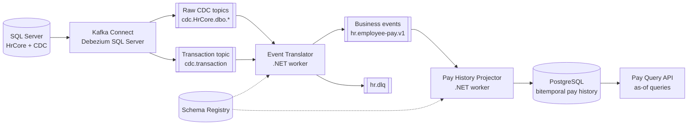

# Architecture

Document id: `architecture`
Status: draft
Last updated: 2026-10-29

## Purpose

How the pipeline is put together and why. For event formats see
[event-design.md](event-design.md).

## Overview



1. SQL Server CDC records row changes of `HrCore` in change tables (capture
   jobs run in SQL Server Agent).
2. Debezium reads the change tables and writes one topic per table plus a
   transaction topic with the begin and end of every source transaction.
3. The Event Translator assembles complete source transactions and turns
   them into business events. Anything it cannot classify goes to `hr.dlq`
   with the reason.
4. The Pay History Projector applies business events to a bitemporal read
   model; the Pay Query API answers "what was the salary on date D, as known
   at time K".

## Components

| Component | Technology | Code |
|---|---|---|
| Source database | SQL Server 2022 Developer with Agent | `db/` |
| Broker | Apache Kafka, single node, KRaft | `docker-compose.yml` |
| CDC | Kafka Connect + Debezium SQL Server connector; a watchdog that restarts the task after one known Debezium failure | `connect/` |
| Contracts | Avro in Confluent Schema Registry | `contracts/` |
| Event Translator | .NET 10 worker | `src/CdcPay.EventTranslator`, `src/CdcPay.Translation` |
| Pay History Projector | .NET 10 worker | `src/CdcPay.PayHistoryProjector`, `src/CdcPay.PayHistory` |
| Pay Query API | ASP.NET Core minimal API | `src/CdcPay.PayQueryApi` |
| Shared host wiring | identity, telemetry, health, operator endpoints | `src/CdcPay.Common` |
| Monitoring | OpenTelemetry Collector, Prometheus, Grafana, Alertmanager, kafka-exporter, alert sink | `monitoring/`, [monitoring.md](monitoring.md) |

Every .NET host serves `/health/live` (process only), `/health/ready`
(dependencies), and `/system/component-identity` (component, version, commit,
branch), and logs one identity line at startup. The hosts run in compose from
multi-stage images as a non-root user; the build identity is passed as build
arguments by `scripts/stack-up.sh`.

Every host also sets up OpenTelemetry: its own meter and activity source
(`CdcPay.*`), ASP.NET Core and runtime metrics, and request traces without
probes. With `OTEL_EXPORTER_OTLP_ENDPOINT` set (compose sets it), metrics and
traces are pushed to the OpenTelemetry Collector, which serves the metrics to
Prometheus; Connect and Kafka are scraped directly. See
[monitoring.md](monitoring.md).

## Event Translator

`src/CdcPay.Translation` holds the logic, with no Kafka dependency:

| Part | Role |
|---|---|
| `Raw/DebeziumParser` | Debezium JSON to typed rows and transaction markers |
| `Assembly/TransactionAssembler` | groups rows by transaction, releases complete transactions in commit order, times out incomplete ones, drops redelivered rows |
| `Assembly/OffsetTracker` | per partition, the lowest offset still in progress: the safe commit point |
| `Classification/EventClassifier` | complete transaction or snapshot row to events, ignored rows, or dead letters |

`src/CdcPay.EventTranslator` is the host: one consumer loop that polls, parses,
assembles, classifies, publishes, and commits. Offsets are committed only after
the output of every earlier message is acknowledged; a publish failure stops
the host, and on restart it resumes from the committed offsets. Because event
ids are deterministic, any duplicate this produces is recognisable downstream.

Debezium writes a transaction's END only when the next transaction begins. A
transaction without END therefore times out only after a later transaction's
BEGIN: while Connect is down, the last transaction waits for the whole outage.
After a task restart, Debezium sends the rows of the transaction that was open
again, with new `total_order` values, and its END counts both sends. The
assembler recognises such a row by its source position (`change_lsn` and
`event_serial_no`), counts it toward the END, and does not hand it out twice.
A row Kafka delivers again (same `total_order`) is dropped.


## Pay History Projector and Query API

`src/CdcPay.PayHistory` holds the read model: the bitemporal merge, a pure
function from current rows and one pay fact to a plan of closed, deleted, and
inserted rows; the PostgreSQL store that runs the plan in one transaction with
the event's `processed_event` row; and the reader behind the as-of queries.
`src/CdcPay.PayHistoryProjector` is the consumer host: it stores an event's
offset only after its transaction commits. `src/CdcPay.PayQueryApi` serves the
queries with a read-only login. Details: [read-model.md](read-model.md).

## Design Decisions

- **Business events, not table mirrors.** One source transaction that states
  one business fact (for example a hire touching three tables) becomes one
  event. The translator waits until the transaction topic reports the
  transaction complete, then classifies it. Unknown shapes are dead-lettered,
  never dropped.
- **Two time axes.** Every event carries valid time (`effectiveFrom`,
  `effectiveTo`) and transaction time (`recordedAt`, the source commit time).
  The read model never overwrites: a new fact closes the previous recorded
  version. All instants are UTC.
- **Deterministic event ids.** Ids derive from the source position (or, for
  snapshot rows, from the row content), so replays and redeliveries produce
  the same ids and consumers can deduplicate.
- **At-least-once delivery, idempotent consumers.** The translator commits
  its input offsets only after its output is acknowledged; the projector
  records processed event ids in the same database transaction as its
  changes.
- **Contracts in the registry.** Business event schemas are registered by
  script only; producers never auto-register, so an incompatible change is
  stopped at registration.
- **Redelivery-aware transaction assembly.** Debezium writes a transaction's
  END only when the next one begins and sends rows again after a task
  restart. The translator lets a transaction wait until a later one has
  begun, and recognises a resent change by its source position (see Event
  Translator above).
- **Repair is explicit.** `connect-watchdog` restarts the Debezium task
  after one known, harmless failure and nothing else. Lossy repairs (a
  re-snapshot after the CDC retention was exceeded) are operator actions with
  a runbook in [operations.md](operations.md), so a loss is never hidden.
- **One translator instance.** Assembling transactions across topics needs a
  single consumer. This is a deliberate PoC limitation.

## Repository Layout

```text
docker-compose.yml   local stack
db/                  source schema, seed data, CDC enablement
connect/             Connect image, Debezium connector configuration and registration, task watchdog
contracts/           event schemas
monitoring/          Prometheus, Grafana, Alertmanager
scripts/             demo scenarios, operations, failure drills
src/                 .NET solution (CdcPay.slnx) and the optional Python consumer
docs/                this documentation
```
