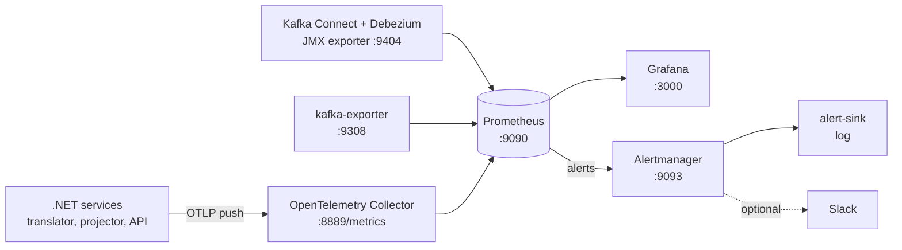

# Monitoring and Alerts

Document id: `monitoring`
Status: active
Last updated: 2026-10-29

## Purpose

What the stack measures, where to see it, which alerts exist, and what to do
when one fires.

## Overview



| Source | What it reports | Scraped at |
|---|---|---|
| .NET services | the metric catalog below, ASP.NET Core and .NET runtime metrics | `otel-collector:8889` (the services push OTLP every 10 s) |
| Kafka Connect | connector and task status, Debezium streaming metrics, JVM | `connect:9404` (JMX exporter agent, `connect/Dockerfile`) |
| Kafka | consumer-group lag, topic offsets | `kafka-exporter:9308` |
| Prometheus, Alertmanager | themselves | `localhost:9090`, `alertmanager:9093` |

Prometheus shows every target as `up` at <http://127.0.0.1:9090/targets>.

The .NET services do not serve `/metrics` themselves: the OpenTelemetry
Prometheus exporter for .NET is still a beta release, so they push OTLP to
the collector, and the collector serves the metrics for Prometheus. Their
series carry `job` = the service name (for example `CdcPay.EventTranslator`)
and `instance` = an id per process start. A series of a stopped process
disappears from the collector after 5 minutes.

## Metric Catalog

Tags are bounded: `event_type` is one of the five event types, `reason` a
dead-letter or ignore reason code, `result` `changed` or `unchanged`. No
tenant, employee, or amount appears in a tag.

| Metric (Prometheus name) | Type | Tags | Meaning |
|---|---|---|---|
| `cdcpay_translator_events_produced_total` | counter | `event_type` | business events published |
| `cdcpay_translator_dlq_produced_total` | counter | `reason` | raw messages dead-lettered |
| `cdcpay_translator_changes_ignored_total` | counter | `reason` | source rows without pay meaning |
| `cdcpay_translator_transactions_open` | gauge | | source transactions seen, not complete yet; normally 1 (below) |
| `cdcpay_translator_transactions_abandoned_total` | counter | | transactions given up as incomplete after 60 s |
| `cdcpay_translator_end_to_end_lag_seconds` | histogram | `event_type` | source commit (`recordedAt`) to publication |
| `cdcpay_projector_events_applied_total` | counter | `result` | events applied to the read model |
| `cdcpay_projector_events_duplicate_total` | counter | | events skipped as already processed |
| `cdcpay_projector_dlq_produced_total` | counter | `reason` | business-topic messages dead-lettered |
| `debezium_metrics_millisecondsbehindsource` | gauge | `context` | source commit to Debezium for the last event (CDC lag) |
| `debezium_metrics_millisecondssincelastevent` | gauge | `context` | time since Debezium saw a change |
| `debezium_metrics_totalnumberofeventsseen` | gauge | `context` | changes seen since the task started |
| `kafka_connect_connector_status`, `kafka_connect_task_status` | gauge, value 1 | `status` | connector and task state (`running`, `failed`, ...) |
| `kafka_consumergroup_lag` | gauge | `consumergroup`, `topic`, `partition` | messages behind the end of the topic |
| `kafka_topic_partition_current_offset` | gauge | `topic`, `partition` | end offset; its growth on `hr.dlq` is the DLQ count |

The open-transaction gauge is normally 1, not 0: Debezium emits a
transaction's END marker only when the next transaction begins, and the
heartbeat starts one every 10 s. A stuck transaction therefore shows as an
abandoned one, not as a high gauge.

## Traces and Logs

The translator starts a producer span per business event and writes its W3C
trace context to the event's `traceparent` header; the projector continues
the trace in a consumer span. Span attributes are the topic, Kafka position,
event type, event id, and outcome. ASP.NET Core requests are traced too,
except probes and the identity endpoint. There is no trace backend in the
stack: the collector receives traces and logs a count per batch
(`docker compose logs otel-collector`). Without
`OTEL_EXPORTER_OTLP_ENDPOINT` (for example under `dotnet run`), nothing is
exported.

In containers the services log JSON lines, one per record, with `TraceId` and
`SpanId` in `Scopes` while a span is active. Log messages name codes, ids,
positions, and counts, never row content (see the rule in
[event-design.md](event-design.md)). Request logs are off (ASP.NET Core logs
at Warning), so probes never appear.

## Dashboard

Grafana at <http://127.0.0.1:3000> (user `admin`, password
`GRAFANA_ADMIN_PASSWORD` from `.env`) opens on **CDC Pay Pipeline**:

| Panel | Shows |
|---|---|
| Connector hrcore-cdc | RUNNING, or NOT RUNNING when its task failed or Connect is down |
| CDC lag | source commit to Debezium, seconds |
| Since last source event | seconds; the heartbeat keeps it below about 15 s |
| Messages in hr.dlq | messages retained on the dead-letter topic |
| Open source transactions | the translator's open-transaction gauge |
| Firing alerts | count, and a table at the bottom |
| Events per second | source changes, events published by type, events projected, duplicates |
| Consumer lag per group | translator and projector |
| CDC and end-to-end lag | CDC lag and the p95 of source commit to business event |
| Dead letters | per 5 minutes, by component and reason |

The dashboard and the datasource are provisioned from `monitoring/grafana/`;
the UI cannot save changes. To change the dashboard, edit
`monitoring/grafana/dashboards/cdc-pay-pipeline.json` (or export it from the
UI into that file) and restart Grafana.

## Alerts

Rules: `monitoring/prometheus/alerts.yml`. Alertmanager sends every alert,
and its resolution, to the `alert-sink` container:

```sh
docker compose logs -f alert-sink
# ALERT FIRING DlqNotEmpty severity=warning since=2026-10-29T18:28:41.569Z summary='4 messages dead-lettered in the last 5 minutes'
```

| Alert | Fires when | First steps |
|---|---|---|
| `ConnectorNotRunning` (critical) | for 1 minute the connector is not reported as running, or its task is not running | `curl -s localhost:8083/connectors/hrcore-cdc/status`; for a failed task read `trace`, then `curl -X POST localhost:8083/connectors/hrcore-cdc/tasks/0/restart`. After every Connect restart the task fails once with a `NullPointerException` in `buildEndTransactionValue` (Debezium 3.6.2, see the journal); the task restart fixes it |
| `CdcEventsStalled` (critical) | Debezium has seen no change for 2 minutes, for 1 minute | the heartbeat changes the source every 10 s, so capture is broken: check SQL Server Agent and the CDC capture job (`EXEC sys.sp_cdc_help_jobs`) |
| `ConsumerLagHigh` (warning) | a consumer group is more than 100 messages behind for 2 minutes | the service's log and `/health/ready`; is it running? |
| `DlqNotEmpty` (warning) | a message reached `hr.dlq` in the last 5 minutes | read the `dlq.reason` and `dlq.error` headers ([operations.md](operations.md)) |
| `TranslatorTransactionsStuck` (warning) | the translator abandoned a source transaction in the last 10 minutes | translator log `Abandoned transaction ...`; the rows are in `hr.dlq` as `IncompleteTransaction` |

Alert labels and annotations name connectors, tasks, topics, groups, and
numbers only.

### Slack

1. Create a Slack incoming webhook.
2. Put its URL, alone on one line, in `monitoring/alertmanager/slack-api-url`
   (git-ignored).
3. Set `ALERTMANAGER_CONFIG=alertmanager-slack.yml` in `.env` and run
   `docker compose up -d alertmanager`.

Alerts then go to the sink and to Slack. Check a configuration with
`docker compose exec alertmanager amtool check-config /etc/alertmanager/alertmanager-slack.yml`.
